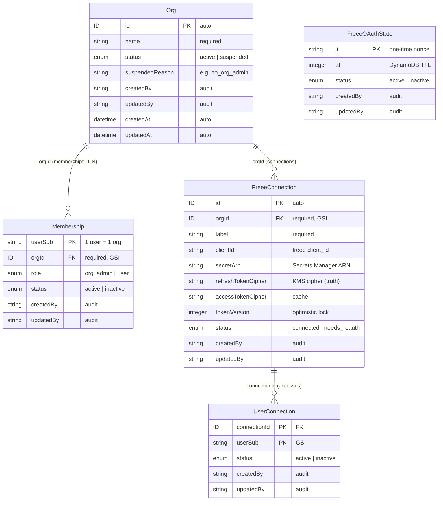
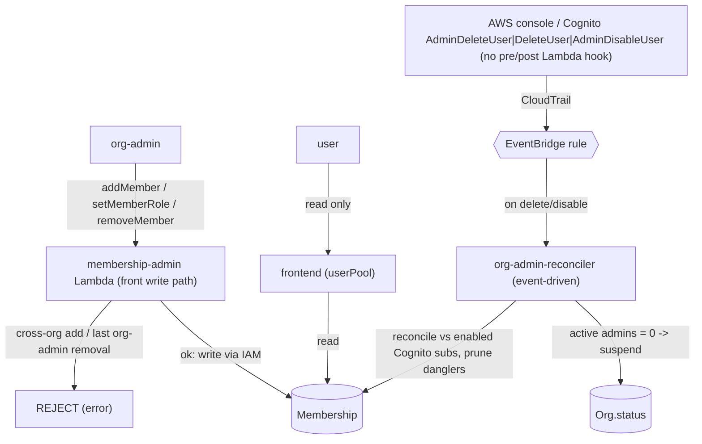

# remote-free-actions — DynamoDB データモデル

Amplify Gen2 data schema（`amplify/data/resource.ts`）で定義された 5 テーブル。
認可モードは userPool（Cognito）。GSI は Amplify の `secondaryIndexes` 由来。

> 図は `docs/img/*.svg`（どのビューアでも描画）。編集用の Mermaid ソースは各図の
> `
` に格納（GitHub 上ではそのままレンダリングされる）。
> 再生成: `npx -y @mermaid-js/mermaid-cli -i docs/img/er.mmd -o docs/img/er.svg -b white`

## 監査エンベロープ（全モデル共通）

全モデルが以下を持つ:

| フィールド | 付与元 |
|---|---|
| `createdAt` / `updatedAt` | **Amplify が自動付与**（readonly システムタイムスタンプ） |
| `createdBy` / `updatedBy` | 書込者（Lambda / app-admin GUI）が create 時 / 更新時に設定 |
| `status` | 汎用ライフサイクル `active`/`inactive`。ドメイン固有 status を持つモデルはそれを使用（Org=`active`/`suspended`、FreeeConnection=`connected`/`needs_reauth`） |

## 不変条件（invariants）

DynamoDB のキー制約で「できるだけ DB に近い層」で強制する。UI ではなくキーで守る。

| 不変条件 | 強制方法 |
|---|---|
| **1 user = 1 org**（member↔org は 1‑N。別 org の user を追加したらエラー） | `Membership` の PK = `userSub`。既に別 org に居る user の membership を作ると **conditional create が PK 重複で失敗**＝エラー |
| user×freee アプリの付与は一意 | `UserConnection` の PK = `(connectionId, userSub)` 複合キー |
| OAuth state nonce は一回限り | `FreeeOAuthState` の PK = `jti` |
| **各 org に org-admin が最低 1 人** | 二段構え。**① 予防（front）**: `membership-admin` Lambda が最後の active org-admin の削除/降格を **reject**。**② 収束（out-of-band）**: `org-admin-reconciler` が Cognito と突合し dangler を掃除、active admin 0 の org を `status=suspended` に（admin 復活で `active`）。②は**イベント駆動**（Cognito 削除/無効化 → CloudTrail → EventBridge、下記） |
| frontend からの membership 書込禁止 | `Membership`/`UserConnection` は **frontend read-only**。書込は Lambda（IAM）経由のみ。org-admin の操作は `membership-admin` カスタム mutation（`addMember`/`setMemberRole`/`removeMember`）だけ |

## ER 図

Mermaid ソース（erDiagram）

> `FreeeOAuthState` は他エンティティと関連を持たない独立テーブル。

## テーブル一覧

| テーブル | PK | 役割 | frontend 書込 | GSI |
|---|---|---|---|---|
| **Org** | `id` | 組織。app-admin が作成、`status` は reconciler が管理 | app-admin のみ | — |
| **Membership** | `userSub` | user↔org＋役割。**1 user = 1 org** を PK で保証 | **不可（read-only）** | `orgId` |
| **FreeeConnection** | `id` | freee アプリ接続（org スコープ）。token 正本 | app-admin（書込は Lambda） | `orgId` |
| **UserConnection** | `(connectionId, userSub)` | user×app 割当（明示 join）。重複付与不可 | **不可（read-only）** | `userSub` |
| **FreeeOAuthState** | `jti` | OAuth state one-time nonce。TTL 自動失効 | app-admin | — |

## 認可・整合フロー

Mermaid ソース（flowchart）

## 設計の要点

- **3階層ロール**: `app-admin`（Cognito group）= Org 作成＋初期 org-admin 任命 /
  `org_admin`（Membership.role）= org 内の freee 登録・user 追加・割当 /
  `user` = GPT 利用。
- **書込は Lambda 経由**: org スコープ認可は純 Amplify group auth で表せないため、
  `Membership` / `UserConnection` の frontend は read-only。書込は IAM の Lambda
  （`membership-admin` の front mutation ／ `org-admin-reconciler`）に集約。UI では
  なく DB 近くで守る。
- **持つデータは最小限**: アプリ所有データ＋再取得不能な OAuth grant
  （`refreshTokenCipher` = KMS 暗号）のみ永続化。freee が都度返すもの（会社一覧・
  名前・user info）は live fetch。identity/email は Cognito 正本（`userSub`/`sub`
  参照のみ、ミラーしない）。`company_id` はリクエスト毎。
- **org-admin 最低 1 人の保証（二段構え）**:
  - **予防（front 経路）**: `membership-admin`（`amplify/functions/membership-admin/`）
    が `removeMember`/`setMemberRole` で最後の active org-admin を **reject**。
    `addMember` は別 org 所属 user を PK 重複で reject（1 user = 1 org）。呼び出し元が
    対象 org の org-admin（または app-admin group）かも Lambda 内で検証。
  - **収束（out-of-band）**: Cognito にはユーザー削除の pre/post Lambda トリガーが
    無いので console/直 API 削除は止められない。`org-admin-reconciler` を
    **イベント駆動**で回す：Cognito `AdminDeleteUser`/`DeleteUser`/`AdminDisableUser`
    → CloudTrail → EventBridge ルール（backend.ts）→ Lambda。enabled な Cognito sub と
    Membership を突合し dangler を掃除、active org-admin 0 の org を
    `status=suspended`（`suspendedReason=no_org_admin`）に。admin 復活で `active`。
    **前提**: region に管理イベント記録の CloudTrail 証跡が必要（無いとルールが発火しない）。
- **token 安定性**: `tokenVersion`（楽観ロック）＋ `status: needs_reauth` は
  freee token incident（単回ローテ×並列同期の永続失効）の教訓を踏襲した設計。

## デプロイ前提 / follow-up

- **CloudTrail 証跡（イベント駆動の前提）**: reconciler は Cognito 管理イベントを
  CloudTrail 経由で EventBridge が受ける前提。証跡の扱いは env で切替（`backend.ts`）:
  - `MANAGEMENT_EVENTS_TRAIL_ARN` を**既存のアカウント/組織証跡の ARN に設定** →
    何も作らず既存を再利用（**推奨・節約**。管理イベント証跡はアカウント最初の1本のみ
    無料、2本目以降は従量課金なので環境ごとの重複を避ける）。
  - **未設定なら** write-only の最小証跡を Amplify 同梱 CDK で自動作成（public
    テンプレとして単体で動く。アカウント最初の1本なら無料）。
  - コスト目安（100ユーザー・削除 月1〜2件）: 証跡1本運用なら実質 $0/月（削除数は
    Lambda 起動数=無料に効くのみ。課金は「管理イベント証跡の本数」で決まる）。
- **初期 org-admin bootstrap**: `addMember(orgId, userSub, role='org_admin')` を
  app-admin（Cognito group）が呼べば作成可能（`membership-admin` が app-admin を
  bypass 許可）。Org 作成 GUI からこの mutation を叩く導線は未実装。
- **suspended org のブロック**: bridge の connect フロー実装時に、`Org.status ===
  'suspended'` の org の接続を使わせないチェックを入れる。現状 bridge は
  not-connected で fail するのみ。
- **backstop（任意）**: CloudTrail 配信は best-effort（遅延/取りこぼし得る）。厳密性が
  要るなら低頻度スケジュール（例: 日次）を保険として併設可。現状はイベント駆動のみ。
